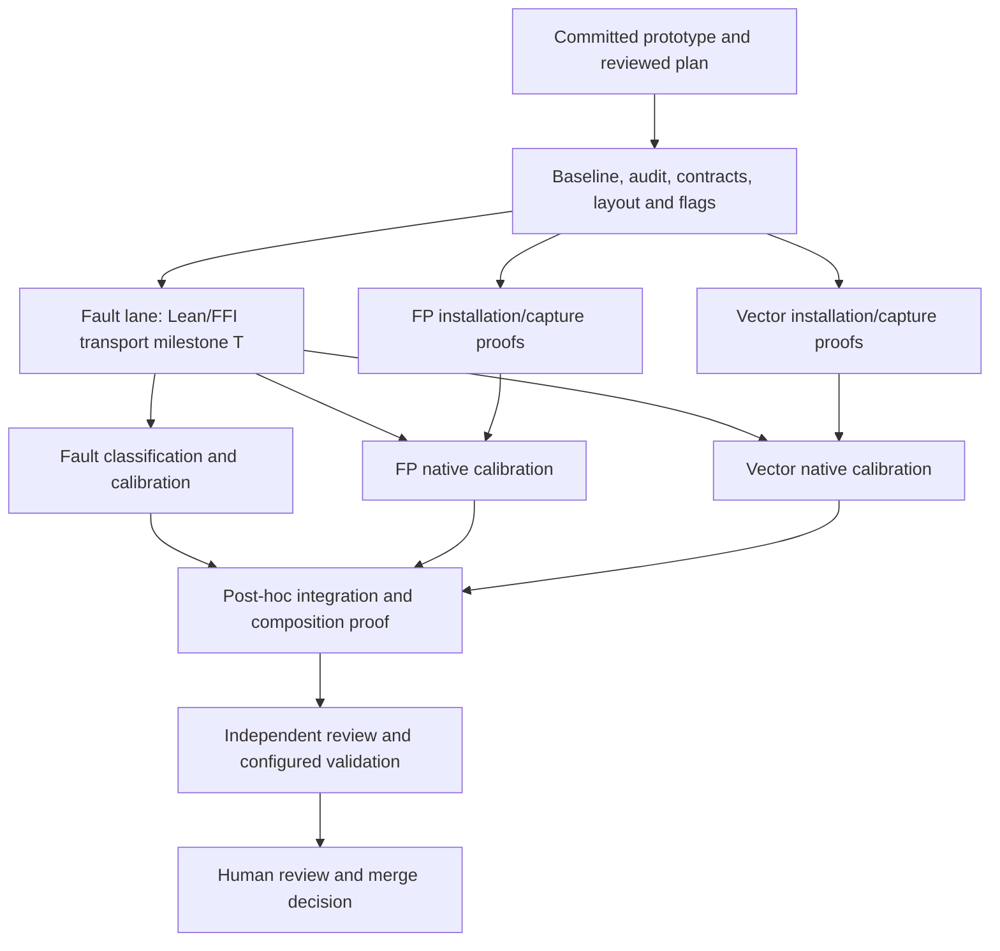

# Observer completion plan

Status: **planning and review only; implementation is not authorized**.
One implementation-coordinator chat is the user's point of contact. Three bounded
worker lanes follow a shared foundation; integrate afterward. No continuously
chasing integration worker. The user retains the merge decision.

## Starting point and goal

Root: `~/workspaces/wruh-mov-observer`, a `jj workspace add` workspace from
`~/code/wruh`, based on GitHub main. Prototype:
`385891242c60389e8548428f8022079eb85e9c7d`; relocated-wrapper fixes:
`50ab63f138a5f9a6d7e34ad281a98b5b5e124887`.[^prototype]
AYXG: `~/workspaces/ayxg-mov-observer`, based on GitHub main
`ff9c1159cc4d7c151ee6709518d5e1ae8c36f215`, with no source changes.

Already proved: MOV/GPR loading, capture, decoding and a modeled protocol with an
explicit PC handoff. Original native calibration exercised capture only. Checked
Lean source hashes are preserved; the relocated wrappers have only syntax checks,
not a fresh execution. **After authorization**, first re-establish the Lean and
native capture baseline from the promoted paths, retaining exact-run provenance.

Goal: an executable single-instruction observer with a compositional proof
relative to the current instruction models, plus native calibration of its
model/OS boundary. Add flags, FP/vector state, real stop/fault handling and a Lean
supervisor with narrow FFI. Minimize instruction complexity and form count.
Semantic-model repairs, optimization, batching, macOS, emulation, bare-host
execution and XSAVE-family work remain outside this pass.

## Dependency DAG and ownership

| Lane | Active-work estimate* | Ordered steps | Unlock / ownership |
|---|---:|---|---|
| Foundation C | 1–3 h | Recheck baseline → field/outcome audit → freeze contract/ABI → flags proof → publish common commit | Execution authorization; coordinator owns shared contracts, layout, emitters/generated context, flags, wrappers and acceptance tests |
| Faulting F | 3–8 h | Lean driver + minimal FFI → usable transport T → classifier/fallback → protocol proofs and calibration | C; owns `Fault/`, `Supervisor/`, `ffi/` |
| FP P | 2–8 h | Select/extract exact forms → installation/capture/restoration proofs → native calibration | Proofs after C, native calibration after T; owns `Fp/`, MXCSR and x87 |
| Vector V | 2–6 h | Alias map → exact forms → installation/capture/restoration proofs → native calibration | Proofs after C, native calibration after T; owns `Vector/`, consumes shared MXCSR contract |
| Integration I | 2–5 h | Collect handoffs → resolve conflicts → compose actual order → re-extract/typecheck/calibrate | Completed F/P/V; coordinator or one freed worker, afterward; owns final composition |

*Rough planning ranges, excluding blocked hardware/CI waits. No completion promise.
No new temporary general-purpose calibration runner: P/V wait for T to execute
their fragments, while F continues its other work. T's handoff pins its immutable
commit and ABI version; P/V calibration evidence records both. The existing Python probe
remains GPR calibration evidence, not the production supervisor. C's immutable
contract commit parents all three lanes. Shared changes return to the coordinator.

## Contract before fan-out

C first produces a small field/outcome table: **raw representation; model
representation or named gap; definedness; installation; observation; owner**.
Cover required GPR/flags/FP/vector state, target memory, FS/GS/segment context,
fault outcomes and model bookkeeping. Audit x87 width/tag/TOP/control/status,
MXCSR and SIMD aliases before freezing the profile. For example, `fpreg : bv512`
does not establish a lossless eight-by-80-bit x87 representation. Gaps are named
obligations, not permission to assume a theorem or silently exclude a field.

Freeze `Profile`, `RequestedState`, `RawSnapshot`, `Observation`, `TargetEvent`,
`CaptureFailure`, an executable `Required` comparison relation and their typed
links to AYXG. The profile records CPU/mode/OS-enabled features, revisions, state
fields, aliases, defined bits, memory layout and admissible states. Establish
coverage independently of implementation success; profile changes need user
agreement. C freezes positive admitted fixtures and required successful outcomes
for every coverage class; lane/integration validation demonstrates those captures.
Reject-all/fail-all implementations cannot pass.

Native acquisition and classification take only the request, fixed profile and
observed bytes/events: **no predicted post-state or expected model edge**. Keep
raw evidence before interpretation. Distinguish architectural state, capability
metadata, reserved encoding and unrepresented fields. Do not treat MXCSR_MASK or
save-image padding as mutable registers, or erase NaNs, signed zero, upper lanes,
flags or faults to obtain agreement.

Freeze the transport signature and synthetic event fixtures. The FFI creates and
reaps tracees, transfers state/memory, resumes/stops and returns bytes/events;
Lean owns decoding, orchestration, comparison and classification. List the
kernel/FFI/compiler laws still externally assumed and calibrated. Maintain a
manifest of exact installation/capture/restoration/fallback instruction forms,
side effects and model support; justify their simplicity without seeking a
global optimality proof.

## Common correctness obligations

C freezes Lean statement signatures, executable acceptance tests and coverage
before worker implementations. Neither comparator nor workers define success.

1. **Input fidelity:** installation establishes every requested field in the
   admitted profile before the target executes. Initialize relevant state, then
   install randomized intended values and validate actual read-back.
2. **Target boundary:** execute the target transition required by the profile.
   Distinguish retirement, synchronous exception, partial progress, interruption
   and harness failure. SIGTRAP alone is insufficient; account for calls/branches,
   TF/RF effects and repeated instructions.
3. **Capture fidelity:** actual capture bytes decode to the original target-stop
   state/event. Missing observations never come from predictions. Model labels
   remain in the symbolic relation; native correspondence need not invent a
   uniquely observable model edge ID.
4. **Noninterference and frame:** prove successful and aborted-prefix effects of
   each fragment; preserve memory outside each declared write footprint.
   Preserve every not-yet-observed target field,
   or establish saved-value/restoration evidence before modifying it. Establish
   private-buffer/code/stack disjointness and addressability for each generated
   case. Prove the actual composition order, not just fragments in isolation.
5. **Codec fidelity:** widths, byte order, aliases, lengths and tags round-trip;
   malformed/truncated records fail closed. State observation adequacy separately
   so encoder/decoder agreement cannot conceal a shared omission.
6. **Fault fidelity:** freeze the target event, stopped PC and available OS
   metadata before redirecting execution. A fallback uses only state/evidence
   proven to correspond to that original stop; never rerun the target and report
   a second outcome as the first. Otherwise return `CaptureFailure`. Observer
   faults, timeouts, OOM and transport errors retain distinct failure reasons.
7. **Comparison fidelity:** conditional on successful faithful capture,
   comparator acceptance is equivalent to independently specified `Required`.
   Assume installation/observer/FFI laws, **not target/model agreement**. A native
   outcome absent from the model remains a mismatch or named coverage obligation.
   Missing fields/incomplete captures cannot pass. Repairable unknowns stay debt;
   genuinely unobservable distinctions require a reviewed justification.
8. **Evidence integrity:** retain exact bytes/models/inputs, profile, CPU/OS,
   source revisions, commands, outcomes and Hypothesis replay evidence. Any new
   structured JSON needs purposeful JSON-LD contexts.

This adapts VTDO's separation of capture correctness, availability, observation
adequacy and comparison correctness.[^vtdo] PBT calibrates held-out obligations;
finite passing tests do not become hardware proofs. Missing native exception
semantics remain explicit calibrated assumptions or unresolved obligations.

## Lane boundaries and test knowledge

**Flags / C:** extract exact capture/restore forms; account for stack effects and
saved-image versus live flags. Freeze their ordering before FP/vector work.

**Faulting / F:** test classification with synthetic transcripts, then native
normal/fault/interruption fixtures with independently known outcomes. Prove the
Lean protocol against specified transport events and calibrate that transport.
A completed-fragment frame proof alone does not justify an aborted prefix.

**FP / P:** own installation, capture and necessary restoration of x87 and MXCSR.
Compare explicit stores/saves by complexity, side effects and model support.
Destructive save/pop needs a restoration/composition proof. Transport unusual raw
patterns without normalization; do not turn this into arithmetic-model repair.

**Vector / V:** own installation, capture and restoration of XMM/YMM/ZMM and mask
registers. Prove aliases, widths, alignment/overlap and legacy/VEX/EVEX upper-lane
effects. Native-capable KVM/container validation records exposed features;
unavailable required AVX-512 evidence stays pending, never a passing skip.

| Stage | Independently available evidence | Assertion |
|---|---|---|
| Installation | Generated request + actual pre-target read-back | Requested state installed; discrepancy stops the case before execution |
| Capture-only calibration | Known seed + separately identified native observation route | Records the seed and satisfies its frame contract |
| Event classification | Synthetic transcripts + native fixtures with established outcomes | Correct category, PC handling and partial effects |
| Arbitrary target | Validated input + captured raw state/event + separately evaluated model | Agreement under `Required`; model prediction is under test |

Test codecs, offsets, aliases, installation, frame properties and malformed
records. Inject wrong payloads, event categories and missing fields to verify
rejection. Two routes sharing the same kernel ABI cross-check each other; they
do not independently prove that ABI. Identify each calibration dependency.

## Coordination and acceptance

One coordinator chat owns requirements, shared files, decisions and status.
After execution authorization, use `jj workspace add` from `~/code/wruh` into
`~/workspaces`, parenting each lane at C's exact commit. Create an AYXG lane only
for an authorized dependency change. Preserve all lane commits.

Three Terra 6.1 workers fit this session's three child slots. Each has one bounded
task/goal, disjoint file ownership and no recursive delegation. Shared changes
go through the coordinator. Handoff only after self-review and validation:
commit, commands/results, theorem names/axioms, evidence paths and open obligations.
Parent review begins on that explicit handoff, not on a running/idle UI label.

Use event messages, otherwise loose five-minute checks without duplicate work.
Record blocked/validating/ready-for-parent-review/complete distinctly in durable
handoffs. Agents sleep during CI waits; an explicitly authorized lightweight
monitor may report new failures/completion. Nothing starts merely because this
plan is agreed.

Integrate after completed handoffs. Reprove combined layout/order and qualify the
combined native harness against exact final source hashes. Preserve PR identity;
no replacement PRs or merges by the coordinator. The user makes the merge decision.

Acceptance rejects `sorry`, new axioms, unreviewed assumptions/profile reductions,
result-dependent exclusions, incomplete-as-pass and unjustified masking. Compare
frozen statements/tests/coverage against the common contract; only reviewed
changes can amend it. These gates expose deviations; independent and human review
still checks whether the specification expresses the intended property.

## Next human gate

Review this plan and Astra's findings. No implementation workers, lane workspaces,
new native experiments, PRs or integration operations are authorized by this plan.

[^prototype]: `wruh` at `385891242c60389e8548428f8022079eb85e9c7d`, `experiments/mov_observer/Protocol.lean`, `protocol_sound` and `protocol_complete`; `evidence/original/validation.txt` records checked hashes and boundaries. Wrapper revision `50ab63f138a5f9a6d7e34ad281a98b5b5e124887` does not add a new native validation claim.
[^vtdo]: `vtdo` at `680c89b6b6960b6b67b701908a23a14c72faa463`, `Convergence/ObserverSketch.lean`, `BoundedCaptureLaws` (69–77), `Noninterfering`, `CaptureFaithful`, `ObservationAdequacy`, `scoped_comparison_characterizes`, `accepted_check_iff` (98–166), availability discussion (184–191).

Mechanics: [official OpenAI subagent documentation](https://learn.chatgpt.com/docs/agent-configuration/subagents). Four total slots is this session's configuration, not a universal limit. JJ provides file isolation; subagent creation alone does not.
