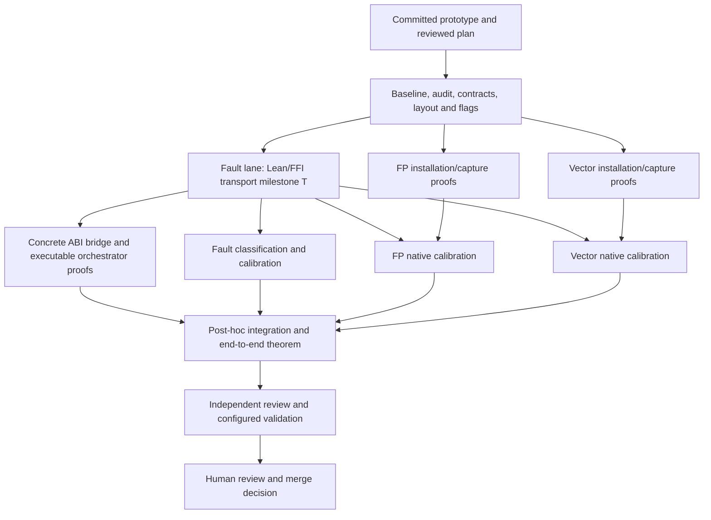

# Observer completion plan

## Governing telos and scope — agreed 2026-11-08

This section governs the work. Older material below has not yet been reconciled
and does not authorize broader work. This update records the agreement only;
cruft removal, implementation and autonomous goal execution have not resumed.
Keep this agreement in VCS when removing it from the working tree later.

The purpose is a minimal, trustworthy native observer that unblocks regression
PBT for existing semantic coverage, not a general verification framework.

### In scope

- Ensure noninterference of native instruction observations: install requested
  state, observe the single target instruction, and capture its result without
  the harness corrupting the observation.
- Treat target-instruction faults as observed outcomes, distinct from harness
  failures.
- Ensure nonexceptional harness runs complete. Trivial transient exceptions may
  be retried where safe; other failures abort the run. Never silently replay the
  target. An aborted run must remain visibly aborted, not become a passing
  comparison. Truly exceptional substrate failures may crash; there is no
  requirement to build recovery machinery for them.
- The user is ALWAYS in the loop on retry/abort decisions. Do not independently
  choose which failures count as transient, whether retry is safe, retry bounds,
  or which cases abort. Propose concrete behavior and resolve it with the user
  before encoding that policy.
- State the concrete obligations needed for these properties using the existing
  instruction semantics and the documented ABI. First check whether suitable
  Lean representations of the ABI already exist, preferably in the distribution;
  reuse them when adequate. Do not presume they exist or invent another framework
  before checking. If absent, state the needed documented ABI properties in Lean
  as a minimal contract stub to which our concrete functions can be bound.
  Distinguish imported ABI contracts from obligations on our own handoff code.
- Use ordinary Lean and a concrete ABI handoff. Do not introduce an effect
  language/interpreter or re-prove the runtime, OS, allocator or ABI itself.
- Extend the AYXG-facing FP representation losslessly as already authorized;
  do not silently narrow coverage to avoid the representation gap.

### Out of scope

- Validating imagined hostile or inexplicable changes underneath the controlled
  harness execution; no concurrent-environment modeling project.
- Paranoia-driven checks, generic ownership/reference-rights frameworks,
  effect languages, or exceptional-failure recovery infrastructure.
- Anything beyond the bare minimum needed to support the regression PBT loop.
  Do not expand the scope to make the specification appear comprehensive.
- AYXG/native semantic comparisons in this observer-specification work. The
  observer serves that later PBT loop; its current task is faithful,
  noninterfering observation.

### User's governing engineering criterion (verbatim)

> anything more than the absolute most bare bones minimal thing required to support the PBT loop for ensuring we're not regressing on existing semantic coverage
> - to that end, if there is any reasonable chance that any pragmatic engineer in the world of any ilk might w/o self owning and destroying their own credibility or correctness might skip a particular check and get away with it, then we should probably fuckin skip it
> - we are not making a throne to the verification and paranoia god
> - we are trying to actually help real humans in this century accomplish real tasks
> - preferably the very first few *in this calendar year*
> - definitely within the next one

Operational test for each proposed addition: what plausible error in our harness
could make the regression PBT misleading, and what is the cheapest adequate way
to prevent it? If that cannot be answered concretely, or normal competent
engineering would reasonably omit it, skip it. This operational test supplements,
not replaces, the user's criterion above.

Status: **planning and review only; implementation is not authorized**.
One implementation-coordinator chat is the user's point of contact. Three bounded
worker lanes follow a shared foundation; integrate afterward. No continuously
chasing integration worker. The user retains the merge decision.

## Starting point and goal

Root: `~/workspaces/wruh-mov-observer`, a `jj workspace add` workspace from
`~/code/wruh`, based on GitHub main. Prototype:
`385891242c60389e8548428f8022079eb85e9c7d`; relocated-wrapper fixes:
`50ab63f138a5f9a6d7e34ad281a98b5b5e124887`.[^prototype]
AYXG: `~/workspaces/ayxg-mov-observer`, based on GitHub main
`ff9c1159cc4d7c151ee6709518d5e1ae8c36f215`, with no source changes.

Already proved: MOV/GPR loading, capture, decoding and a modeled protocol with an
explicit PC handoff. Original native calibration exercised capture only. Checked
Lean source hashes are preserved; the relocated wrappers have only syntax checks,
not a fresh execution. **After authorization**, first re-establish the Lean and
native capture baseline from the promoted paths, retaining exact-run provenance.

Goal: an executable single-instruction observer with an end-to-end refinement
proof connecting its actual Lean orchestrator, concrete ABI bridge and exact
harness bytes to faithful observation and noninterference, relative to the
observer instruction models and explicitly listed external foundations. Native
calibration cross-checks those foundations. Add flags, FP/vector state, real
stop/fault handling and a Lean supervisor with narrow FFI. Minimize instruction
complexity and form count.
Semantic-model repairs, optimization, batching, macOS, emulation, bare-host
execution and XSAVE-family work remain outside this pass.

## Dependency DAG and ownership



| Lane | Active-work estimate* | Ordered steps | Unlock / ownership |
|---|---:|---|---|
| Foundation C | 2–4 h | Recheck baseline → field/outcome audit → freeze ABI/proof route and end-to-end statement → flags proof → publish common commit | Execution authorization; coordinator owns shared contracts, layout, emitters/generated context, flags, wrappers and acceptance tests |
| Faulting F | 4–12 h | Lean driver + minimal FFI → usable transport T → concrete bridge/orchestrator refinement and classifier/fallback proofs → calibration | C; owns `Fault/`, `Supervisor/`, `ffi/`; bridge proofs B are required at final handoff |
| FP P | 2–8 h | Select/extract exact forms → installation/capture/restoration proofs → native calibration | Proofs after C, native calibration after T; owns `Fp/`, MXCSR and x87 |
| Vector V | 2–6 h | Alias map → exact forms → installation/capture/restoration proofs → native calibration | Proofs after C, native calibration after T; owns `Vector/`, consumes shared MXCSR contract |
| Integration I | 3–8 h | Collect handoffs including B → resolve conflicts → compose actual order → prove end-to-end statement → re-extract/typecheck/calibrate | Completed F/P/V; coordinator or one freed worker, afterward; owns final composition |

*Rough planning ranges, excluding blocked hardware/CI waits. Re-estimate after C
selects and checks the concrete bridge proof route; no completion promise.
No new temporary general-purpose calibration runner: P/V wait for T to execute
their fragments, while F continues its other work. T's handoff pins its immutable
commit and ABI version; P/V calibration evidence records both. The existing Python probe
remains GPR calibration evidence, not the production supervisor. C's immutable
contract commit parents all three lanes. Shared changes return to the coordinator.
T permits calibration to start; it is not evidence that B or the end-to-end proof
is complete. Missing bridge semantics must be reported, never replaced by a new
assumption that our own wrapper behaves correctly.

## Contract before fan-out

C first produces a small field/outcome table: **raw representation; model
representation or named gap; definedness; installation; observation; owner**.
Cover required GPR/flags/FP/vector state, target memory, FS/GS/segment context,
fault outcomes and model bookkeeping. Audit x87 width/tag/TOP/control/status,
MXCSR and SIMD aliases before freezing the profile. For example, `fpreg : bv512`
does not establish a lossless eight-by-80-bit x87 representation. Gaps are named
obligations, not permission to assume a theorem or silently exclude a field.

Freeze `Profile`, `RequestedState`, `RawSnapshot`, `Observation`, `TargetEvent`,
`CaptureFailure`, an executable `Required` comparison relation and their typed
links to AYXG. The profile records CPU/mode/OS-enabled features, revisions, state
fields, aliases, defined bits, memory layout and admissible states. Establish
coverage independently of implementation success; profile changes need user
agreement. C freezes positive admitted fixtures and required successful outcomes
for every coverage class; lane/integration validation demonstrates those captures.
Reject-all/fail-all implementations cannot pass.

Native acquisition and classification take only the request, fixed profile and
observed bytes/events: **no predicted post-state or expected model edge**. Keep
raw evidence before interpretation. Distinguish architectural state, capability
metadata, reserved encoding and unrepresented fields. Do not treat MXCSR_MASK or
save-image padding as mutable registers, or erase NaNs, signed zero, upper lanes,
flags or faults to obtain agreement.

Freeze the transport signature and synthetic event fixtures. The FFI creates and
reaps tracees, transfers state/memory, resumes/stops and returns bytes/events;
Lean owns decoding, orchestration, comparison and classification. List external
kernel, Lean runtime/compiler and imported primitive contracts separately from
project-owned bridge obligations; the latter must be proved. Maintain a
manifest of exact installation/capture/restoration/fallback instruction forms,
side effects and model support; justify their simplicity without seeking a
global optimality proof.

## Required end-to-end proof

C freezes one typechecked top-level theorem statement over the actual executable
Lean entry point, not just a parallel specification. During planning, a Lean goal
schema records the obligations without pretending the unimplemented entry point
already exists; its concrete instantiation is a required integration artifact.
`ObserverEndToEndGoal.lean` states that schema, composes the component obligations,
and checks that the complete goal rules out an observer with no successes. Its
execution/trace definitions must later be bound to the actual artifacts; their
names or a typecheck alone do not establish that connection.

**No divergence is a required proof obligation.** Assuming the target instruction
terminates and the agreed current AYXG stub semantics and external contracts
hold, every execution of our orchestrator, concrete bridge and harness must
terminate with a classified result. This applies independently of the additional
conditions for successful capture. Infinite runs, stuck paths and unhandled
aborts cannot be accepted as alternative outcomes or disappear from the execution
model. A timeout/incomplete label is not a substitute for the termination proof.
Prove termination of our loops, retries, fallbacks and foreign-call sequencing;
only target termination and explicitly scoped external primitive progress are
premises. Valid arguments, buffer safety and our own calls' correct behavior are
component obligations, not assumptions.
The required proof chain is:

```text
actual Lean orchestrator execution
  → concrete ABI/FFI operations refine the specified transport
  → transport and stop handling implement the observation protocol
  → exact installation/capture/restoration bytes satisfy their contracts
  → decoded result describes the original target outcome, with observer framing
```

The theorem composes the following obligations; none can be discharged merely by
assuming that the project-owned component has the intended behavior:

1. **Executable orchestrator refinement (F):** connect the real entry point,
   sequencing, loops, decoding and all success/error paths to the protocol trace.
   Proving a state machine that the executable never demonstrably follows is
   insufficient. Freeze how Lean effects are interpreted and related to events.
2. **Concrete ABI bridge refinement (F/B):** prove the project-owned marshalling,
   wrappers and effect interpreter against the transport contract. Cover widths,
   signedness, byte layout, alignment, ownership/lifetimes and aliasing of buffers,
   Lean FFI object conventions, permitted clobbers, and failures/short transfers.
   Relate host-side calls to the intended tracee, registers, memory and stopped
   event; never conflate host ABI state with the target's machine state.
3. **Harness and stop refinement (F/P/V plus C flags):** preserve the original
   target outcome through stop classification, redirection and capture. Prove
   the exact instruction sequence's installation, successful/aborted capture,
   restoration and memory/register frame properties, including fault fallback.
4. **Final composition (I):** instantiate these lemmas for the linked executable,
   actual layouts and stub order. For admitted requests, every successful result
   must describe that same target execution from the installed requested state;
   observer effects stay within declared footprints or their proved restoration
   account. Failures remain classified, never fabricated observations. Add the
   explicit `EndToEnd.noDivergence` obligation and successful-capture availability.
   F proves total termination of the actual Lean program, including concrete
   foreign behavior, conditional on target termination and the agreed foundations.
   Compiler/runtime termination and return preservation carry that proof to the
   binary. Additional availability premises require successful observations;
   otherwise finite classified failures remain possible, but divergence does not.
   Termination and success must be derived, not assumed for project-owned code;
   reject-all correctness cannot pass.

C must name the concrete proof representation and source-to-artifact connection
for every project-owned bridge function before fan-out. C's proof-route gate
demonstrates one representative actual ABI operation, including marshalling and
a failure path, in that representation before dependent lanes start. This is
future foundation work, not authorization to implement it during planning.
A possible bounded route
is extraction of a tiny pinned compiled shim into AYXG, using explicit imported
OS/runtime primitive contracts; if that route cannot model a required operation,
report the exact gap before delegating dependent proof work. No new general C
verifier or compiler-correctness project is implicitly authorized. A contract
attached to an opaque implementation or passing PBT is not the bridge proof.

Keep an assumption/dependency ledger: **component; exact source/artifact;
semantic representation; proof or external foundation; owning theorem**. Compiler
and runtime preservation, kernel primitive behavior and observer-instruction
semantics may remain explicit foundations. Our own glue, codecs, orchestration
and ABI adaptation may not migrate into that list. Treat the target outcome as
the outcome being observed; target/model agreement is never a premise of the
observer theorem or the separate comparison theorem. Preserve independent native
evidence and calibration of foundations. Unproved obligations keep the end-to-end
claim open even if component tests pass.

The compiler/runtime preservation laws must be parametric in the **same concrete
foreign semantics**, including preservation of total termination; they cannot
already assume our bridge's abstract contract. C binds all execution predicates exhaustively to
the actual artifacts. It binds `targetIn`, invocation counting and frame relations
to the original requested target occurrence and explicit effects, independently
of decoded observations. Exactly one invocation can include architectural
partial progress; fallback never starts a second invocation.

## Common correctness obligations

C freezes Lean statement signatures, executable acceptance tests and coverage
before worker implementations. Neither comparator nor workers define success.

1. **Input fidelity:** installation establishes every requested field in the
   admitted profile before the target executes. Initialize relevant state, then
   install randomized intended values and validate actual read-back.
2. **Target boundary:** execute the target transition required by the profile.
   Distinguish retirement, synchronous exception, partial progress, interruption
   and harness failure. SIGTRAP alone is insufficient; account for calls/branches,
   TF/RF effects and repeated instructions.
3. **Capture fidelity:** actual capture bytes decode to the original target-stop
   state/event. Missing observations never come from predictions. Model labels
   remain in the symbolic relation; native correspondence need not invent a
   uniquely observable model edge ID.
4. **Noninterference and frame:** prove successful and aborted-prefix effects of
   each fragment; preserve memory outside each declared write footprint.
   Preserve every not-yet-observed target field,
   or establish saved-value/restoration evidence before modifying it. Establish
   private-buffer/code/stack disjointness and addressability for each generated
   case. Prove the actual composition order, not just fragments in isolation.
5. **Codec fidelity:** widths, byte order, aliases, lengths and tags round-trip;
   malformed/truncated records fail closed. State observation adequacy separately
   so encoder/decoder agreement cannot conceal a shared omission.
6. **Fault fidelity:** freeze the target event, stopped PC and available OS
   metadata before redirecting execution. A fallback uses only state/evidence
   proven to correspond to that original stop; never rerun the target and report
   a second outcome as the first. Otherwise return `CaptureFailure`. Observer
   faults, timeouts, OOM and transport errors retain distinct failure reasons.
7. **Comparison fidelity:** conditional on successful faithful capture,
   comparator acceptance is equivalent to independently specified `Required`.
   Discharge project-owned installation/observer/bridge laws with the component
   proofs above, **not target/model agreement**. A native
   outcome absent from the model remains a mismatch or named coverage obligation.
   Missing fields/incomplete captures cannot pass. Repairable unknowns stay debt;
   genuinely unobservable distinctions require a reviewed justification.
8. **Evidence integrity:** retain exact bytes/models/inputs, profile, CPU/OS,
   source revisions, commands, outcomes and Hypothesis replay evidence. Any new
   structured JSON needs purposeful JSON-LD contexts.

This adapts VTDO's separation of capture correctness, availability, observation
adequacy and comparison correctness.[^vtdo] PBT calibrates held-out obligations;
finite passing tests do not become hardware proofs. Missing native exception
semantics remain explicit calibrated assumptions or unresolved obligations.

## Lane boundaries and test knowledge

**Flags / C:** extract exact capture/restore forms; account for stack effects and
saved-image versus live flags. Freeze their ordering before FP/vector work.

**Faulting / F:** test classification with synthetic transcripts, then native
normal/fault/interruption fixtures with independently known outcomes. Prove the
executable Lean orchestrator and concrete bridge refine the specified transport
and protocol; calibrate that transport independently. T is a usable transport
milestone; completed F also supplies B and the exception-path proof obligations.
A completed-fragment frame proof alone does not justify an aborted prefix.

**FP / P:** own installation, capture and necessary restoration of x87 and MXCSR.
Compare explicit stores/saves by complexity, side effects and model support.
Destructive save/pop needs a restoration/composition proof. Transport unusual raw
patterns without normalization; do not turn this into arithmetic-model repair.

**Vector / V:** own installation, capture and restoration of XMM/YMM/ZMM and mask
registers. Prove aliases, widths, alignment/overlap and legacy/VEX/EVEX upper-lane
effects. Native-capable KVM/container validation records exposed features;
unavailable required AVX-512 evidence stays pending, never a passing skip.

| Stage | Independently available evidence | Assertion |
|---|---|---|
| Installation | Generated request + actual pre-target read-back | Requested state installed; discrepancy stops the case before execution |
| Capture-only calibration | Known seed + separately identified native observation route | Records the seed and satisfies its frame contract |
| Event classification | Synthetic transcripts + native fixtures with established outcomes | Correct category, PC handling and partial effects |
| Arbitrary target | Validated input + captured raw state/event + separately evaluated model | Agreement under `Required`; model prediction is under test |

Test codecs, offsets, aliases, installation, frame properties and malformed
records. Inject wrong payloads, event categories and missing fields to verify
rejection. Two routes sharing the same kernel ABI cross-check each other; they
do not independently prove that ABI. Identify each calibration dependency.

## Coordination and acceptance

One coordinator chat owns requirements, shared files, decisions and status.
After execution authorization, use `jj workspace add` from `~/code/wruh` into
`~/workspaces`, parenting each lane at C's exact commit. Create an AYXG lane only
for an authorized dependency change. Preserve all lane commits.

Three Terra 6.1 workers fit this session's three child slots. Each has one bounded
task/goal, disjoint file ownership and no recursive delegation. Shared changes
go through the coordinator. Handoff only after self-review and validation:
commit, commands/results, theorem names/axioms, evidence paths and open obligations.
Parent review begins on that explicit handoff, not on a running/idle UI label.

Use event messages, otherwise loose five-minute checks without duplicate work.
Record blocked/validating/ready-for-parent-review/complete distinctly in durable
handoffs. Agents sleep during CI waits; an explicitly authorized lightweight
monitor may report new failures/completion. Nothing starts merely because this
plan is agreed.

Integrate after completed handoffs. Typecheck the concrete end-to-end theorem and
its composed proof, inspect its assumptions/dependency ledger, and qualify the
combined native harness against exact final source hashes. Preserve PR identity;
no replacement PRs or merges by the coordinator. The user makes the merge decision.

Acceptance rejects `sorry`, new axioms, unreviewed assumptions/profile reductions,
result-dependent exclusions, incomplete-as-pass, unjustified masking and an
unproved project-owned bridge hidden behind a transport contract. Compare
frozen statements/tests/coverage against the common contract; only reviewed
changes can amend it. These gates expose deviations; independent and human review
still checks whether the specification expresses the intended property.

## Next human gate

Review this plan and Astra's findings. No implementation workers, lane workspaces,
new native experiments, PRs or integration operations are authorized by this plan.

[^prototype]: `wruh` at `385891242c60389e8548428f8022079eb85e9c7d`, `experiments/mov_observer/Protocol.lean`, `protocol_sound` and `protocol_complete`; `evidence/original/validation.txt` records checked hashes and boundaries. Wrapper revision `50ab63f138a5f9a6d7e34ad281a98b5b5e124887` does not add a new native validation claim.
[^vtdo]: `vtdo` at `680c89b6b6960b6b67b701908a23a14c72faa463`, `Convergence/ObserverSketch.lean`, `BoundedCaptureLaws` (69–77), `Noninterfering`, `CaptureFaithful`, `ObservationAdequacy`, `scoped_comparison_characterizes`, `accepted_check_iff` (98–166), availability discussion (184–191).

Mechanics: [official OpenAI subagent documentation](https://learn.chatgpt.com/docs/agent-configuration/subagents). Four total slots is this session's configuration, not a universal limit. JJ provides file isolation; subagent creation alone does not.
