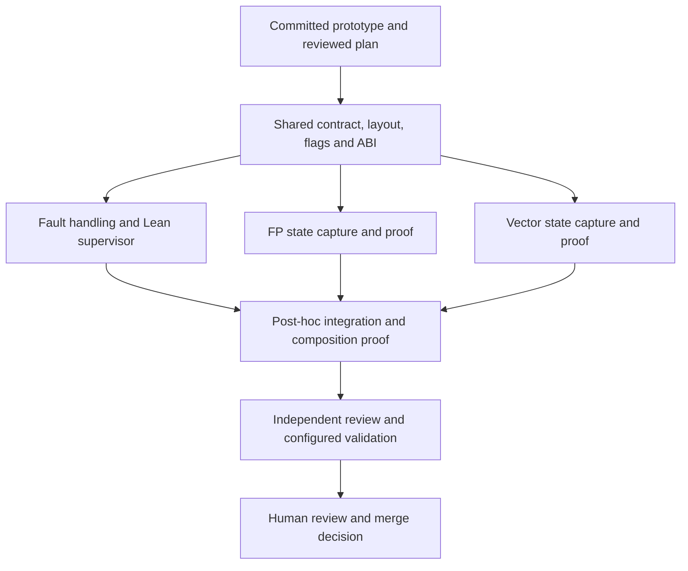

# Observer completion plan

Status: **planning and review only; implementation is not authorized**.
Use one implementation-coordinator chat that the user follows. Integrate the
finished lanes afterward; there is no continuously chasing integration worker.
The user retains the merge decision.

## Starting point and goal

Root workspace: `~/workspaces/wruh-mov-observer`, created with `jj workspace add`
from `~/code/wruh`, based on GitHub main. Prototype commit:
`385891242c60389e8548428f8022079eb85e9c7d`.[^prototype]
AYXG dependency workspace: `~/workspaces/ayxg-mov-observer`, based on GitHub main
`ff9c1159cc4d7c151ee6709518d5e1ae8c36f215`; no AYXG changes yet.

Already proved: MOV/GPR loading, capture, byte decoding, and a modeled protocol
with an explicit PC handoff. Native calibration has exercised capture only.
Still required: flags, FP/vector observations, real stop/fault handling, and the
Lean supervisor's narrow FFI boundary. Preserve the existing proof, rather than
silently promoting its modeled handoff to a proved Linux implementation.

Goal: an executable single-instruction observer whose admitted profile has a
compositional proof relative to the current instruction models, plus independent
native calibration of the model/OS boundary. Minimize both instruction complexity
and instruction-form count. No semantic-model repair campaign, optimization,
batching, macOS, emulation, bare-host execution, or XSAVE-family work in this pass.

## Dependency DAG and file ownership

| Lane | Rough active-work size* | Ordered work | Unlock / ownership |
|---|---:|---|---|
| Shared foundation C | 1–3 h | Inventory actual model fields → freeze profile/layout/outcomes → specify ABI → flags stub and proof → publish contract commit | Starts after execution authorization; coordinator owns `Contract/`, `Layout/`, `Flags/` and acceptance tests |
| Faulting F | 3–8 h | Decode stop events → preserve stopped state → Lean driver + minimal FFI → fault-aware capture → proofs/calibration | C; owns `Fault/`, `Supervisor/`, `ffi/`; supplies an injectable transport for the other lanes |
| FP P | 2–8 h | Audit representability → select/extract exact capture forms → decode and prove → native calibration | C; owns `Fp/`; owns MXCSR and x87 state, including their interpretation |
| Vector V | 2–6 h | Define alias/storage mapping → select/extract exact stores → prove widths/frame → native calibration | C; owns `Vector/`; consumes the common MXCSR contract without redefining it |
| Integration I | 2–5 h | Collect completed handoffs → resolve conflicts → compose actual stub order → re-extract/typecheck/calibrate combined harness | F/P/V; coordinator or one freed worker slot, afterward |

*Planning estimates, not completion promises; exclude blocked hardware/CI waits.
P/V may build proofs and calibrate their fragments independently of F. Their
final executable integration depends on F's concrete transport. C's contract
commit, not a moving workspace name, is the common parent of all three lanes.
Any newly discovered shared requirement returns to C before dependent edits.

## Contract to freeze before implementation fans out

Define `Profile`, `RequestedState`, `RawSnapshot`, `Observation`, `TargetEvent`,
`CaptureFailure`, and their typed relation to the AYXG environment. The profile
records CPU features, execution mode, OS-enabled state, model/tool revisions,
state fields, aliasing, defined-bit rules, memory layout and admitted states.
Admission must be executable and independent of whether a comparison passes.

Record raw bytes and OS metadata before interpreting them. Give every field a
purpose: architectural state, capability metadata, reserved encoding, or an
explicitly unrepresented field. Preserve raw evidence even where the comparison
uses a justified projection. Do not equate MXCSR_MASK or reserved save-image
padding with mutable registers. Do not canonicalize away NaNs, signed zero,
upper vector lanes, flag bits, or faults merely to obtain agreement.

Audit x87 width/tag/TOP/control/status and SIMD aliases against the actual model;
the current embedding's `fpreg : bv512` is not itself evidence of a lossless
eight-by-80-bit x87 representation. Missing semantics or representability is a
named obligation to report, not permission to assume the desired theorem or
shrink the advertised profile. Final profile changes require user agreement.

Specify the smallest OS interface: create/reap tracee, install/read state and
memory, resume/stop, obtain event information. Lean owns orchestration, decoding,
comparison and failure classification; FFI only transports bytes/events. State
which FFI/kernel laws remain externally calibrated assumptions. The modeled
target edge is not an oracle for the event the native observer reports.

## Common correctness obligations

These are proposed acceptance statements to encode as Lean declarations and
executable tests in C. Freeze their signatures, profile and expected coverage
independently of the worker implementations.

1. **Input fidelity:** for every admitted request, installation establishes the
   requested projected state before the target executes. Initialize all relevant
   state, then install randomized intended values; validate actual installation.
2. **Target boundary:** execute exactly the target transition required by the
   profile. Distinguish retirement, synchronous exception, partial progress,
   external interruption and harness failure. A SIGTRAP alone proves none of this.
   Calls/branches, TF/RF effects and repeated instructions need explicit treatment.
3. **Capture fidelity:** decoding the actual capture bytes gives the pre-capture
   target state/event. Do not use predicted values to fill missing observations.
   Model edge/control labels stay in the symbolic relation; native event-to-edge
   correspondence is explicit and need not invent an unobservable unique edge ID.
4. **Noninterference and frame:** each fragment preserves every modeled field
   outside its declared writes and every memory location outside its footprint.
   Declare private-buffer/code/stack disjointness and addressability assumptions;
   establish them for generated cases rather than assuming arbitrary target code
   cannot reach observer memory. Prove composition for the actual fragment order.
5. **Codec fidelity:** fixed widths, byte order, register aliases, record lengths
   and tags round-trip; malformed/truncated records fail closed. Preserve the
   required distinctions under a separately stated observation-adequacy relation.
6. **Fault fidelity:** retain fault identity, stopped PC and permitted partial
   effects before any fallback. Fallback observes the same stopped execution;
   it must not rerun the target and call the second outcome the first. Observer
   faults, timeouts, OOM and transport errors produce typed capture failures.
7. **Comparison fidelity:** successful comparison is equivalent to the fixed
   required relation, given the explicitly enumerated model/OS assumptions.
   Missing fields and incomplete captures cannot become successful comparisons.
   Repairable unknowns remain tracked debt; genuinely unobservable distinctions
   need a reviewed justification, not a blanket mask.
8. **Evidence integrity:** bind exact bytes, models, inputs, profile, CPU/OS data,
   source revisions, commands and outcomes. Retain Hypothesis examples and replay
   data. If structured JSON is added, provide purposeful JSON-LD contexts.

This follows VTDO's separation of noninterference, capture fidelity, observation
adequacy and comparison correctness; it is an adaptation, not a claim that the
observer instantiates the whole VTDO development.[^vtdo] PBT supports the
individual held-out obligations; finite passing tests are not hardware proofs.

## Lane-specific proof and calibration boundaries

**Flags / C:** choose exact capture/restore forms only after extraction and model
inspection; account for any stack use and differences between a saved flags image
and live architectural flags. Establish ordering before FP/vector capture.

**Faulting / F:** test the classifier separately with synthetic event sequences,
then native normal/fault/interruption cases with independently known outcomes.
Snapshot target state before a fault-capable observer operation. A failed fallback
is a capture failure. Prove the Lean protocol state machine against its specified
FFI events; calibrate those events against kernel observations.

**FP / P:** first compare explicit save/store alternatives by instruction count,
side effects and model availability. No destructive x87 save/pop is acceptable
without a proved restoration/composition account. Record x87 payload/control,
tags/TOP/status and MXCSR as the fixed profile requires. Separate exceptional raw
patterns from rounding and arithmetic semantics; test transport without silently
normalizing values. A model gap may block this lane without blocking other work.

**Vector / V:** prove the alias map for XMM/YMM/ZMM and mask registers and capture
all enabled bits in the approved profile. Check legacy/VEX/EVEX upper-lane effects,
alignment and overlap. Use native-capable KVM/container hosts, recording exposed
features; unavailable AVX-512 validation remains pending, not a passing skip.

Every lane needs PBTs for codecs, offsets/aliasing, frame conditions, input-state
installation and malformed-record rejection where independently knowable. Use
deliberate corruption to check that observers/comparators can reject wrong data;
an encoder tested only against its own decoder is insufficient calibration.

## Coordination, review and handoff

One coordinator chat owns requirements, the DAG, contracts, decisions and status.
At execution time, create each lane with `jj workspace add` from `~/code/wruh`
under `~/workspaces`, explicitly parenting it at the agreed common commit. Make
an AYXG lane only if an authorized dependency change is actually required.
Assign disjoint files; workers request shared-contract changes through the
coordinator rather than independently editing them. Preserve all lane commits.

Three Terra 6.1 workers fit this session's three child slots. Use one bounded
task/goal per lane, not recursive delegation. A worker hands off only after its
own review and validation, with commit ID, exact commands/results, theorem names,
axiom report, evidence paths and unresolved obligations. A running/idle UI label
is not a completion report. Parent review starts on the explicit completed handoff.

Use worker messages for material events; otherwise one loose five-minute status
check, with no busy polling or duplicate reviews. Record blocked, validating,
ready-for-parent-review and complete distinctly. During external CI waits,
implementation agents can go dormant; a later explicitly authorized lightweight
monitor only reports new failures or completion. Preserve durable handoff files
so a coordinator/app restart does not lose task identity or completion evidence.

Integrate after the lanes finish. The integration pass must prove the combined
layout/order, compare the final source hashes to validated artifacts, and run
the combined native harness: passing fragment checks do not establish composition.
Keep branch/PR identities; no replacement PRs or forge merges by the coordinator.

Acceptance rejects `sorry`, new axioms, unreviewed hypotheses/profile reductions,
result-dependent exclusions, missing native evidence marked as passed, and raw
byte masking without an architectural justification. The coordinator retains the
acceptance tests; compare their content/signatures against the agreed contract.
These controls make deviations visible and rejectable, not logically impossible:
the adequacy of the specification still needs independent and human review.

## Next human gate

Review this plan and Astra's findings. No implementation workers, lane workspaces,
new native experiments, PRs, or integration operations are authorized by this plan.

[^prototype]: `wruh` at `385891242c60389e8548428f8022079eb85e9c7d`, `experiments/mov_observer/Protocol.lean`, `protocol_sound` and `protocol_complete`; `evidence/original/validation.txt` lists checked input hashes and boundaries.
[^vtdo]: `vtdo` at `680c89b6b6960b6b67b701908a23a14c72faa463`, `Convergence/ObserverSketch.lean`, `Noninterfering`, `CaptureFaithful`, `ObservationAdequacy`, `scoped_comparison_characterizes`, and `accepted_check_iff` (lines 98–166).

Coordination mechanics: [official OpenAI subagent documentation](https://learn.chatgpt.com/docs/agent-configuration/subagents). The four-slot limit above is this live session's configured limit, not a universal product limit. JJ supplies the requested workspace isolation; subagent creation alone does not isolate files.
